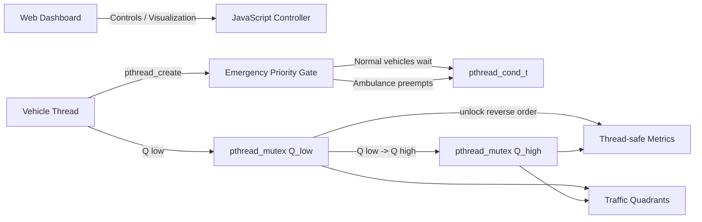

# Multi-Threaded Traffic Light Intersection Controller

A high-performance C++ POSIX simulation demonstrating deadlock prevention, mutual exclusion, priority preemption, condition variables, thread-safe metrics, and a real-time smart-city dashboard.

## Highlights

- Native `pthread_create` vehicle threads for four approaches
- Four quadrant mutex resources (`Q0–Q3`)
- Strict ascending-resource lock ordering (`Q_low → Q_high`)
- Ambulance priority corridor with `pthread_cond_wait` / `pthread_cond_broadcast`
- Thread-safe throughput, contention, and active-lock telemetry
- ANSI color-coded system-call terminal output
- Canvas-based interactive browser dashboard

## Architecture



The resource hierarchy assigns every quadrant a fixed rank: NW=0, NE=1, SW=2, SE=3. Each vehicle acquires resources only from low to high, preventing cyclic wait and guaranteeing deadlock-free execution when protocol is enabled.

## Requirements

- Ubuntu/Linux
- GNU `g++`
- POSIX Threads support
- Modern web browser

## Build and Run

```bash
make
make run
```

Individual commands:

```bash
g++ -Wall -pthread -std=c++11 main.cpp -o traffic_controller
./traffic_controller
```

Clean build artifacts:

```bash
make clean
```

Open `index.html` directly in a browser, or serve the workspace:

```bash
python3 -m http.server 8080
```

Then visit `http://localhost:8080`.

## Concurrency Design

### Resource hierarchy

The intersection is divided into NW, NE, SW, and SE quadrants. The engine locks both required quadrants in ascending order. For example, a vehicle requiring SE and NW locks Q0 then Q3, never Q3 then Q0.

### Emergency preemption

Regular vehicle threads wait on `emergency_cond` while an ambulance owns the priority corridor. The ambulance logs its preemption, crosses, and broadcasts to blocked threads. This is signal-based priority handling rather than busy waiting.

### Web dashboard

The dashboard is a self-contained simulation UI intended for demonstrations. It visualizes thread state and OS telemetry; it does not claim direct control of native POSIX threads without a network bridge.

## Project Structure

```text
Multi-Threaded Traffic Light Intersection/
├── main.cpp
├── Makefile
├── index.html
└── README.md
```

## Educational Team Credits

Developed as a university Operating Systems concurrency project and hackathon demonstration.

- Systems Architecture: C++ and POSIX synchronization
- Interface Design: HTML5 Canvas and responsive Tailwind CSS
- Concurrency Design: Resource hierarchy and condition-variable preemption
